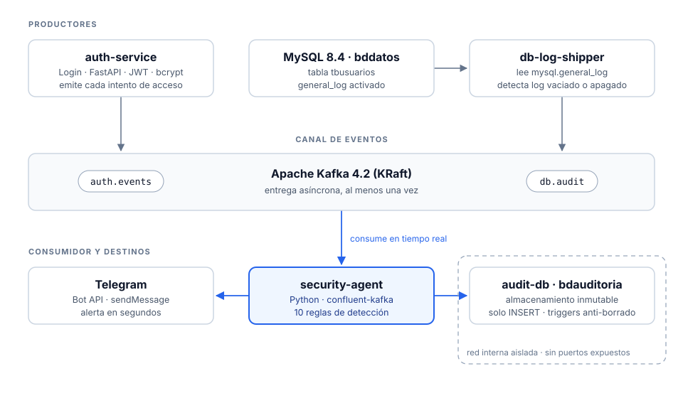
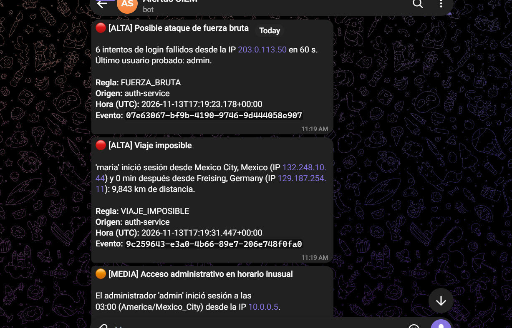
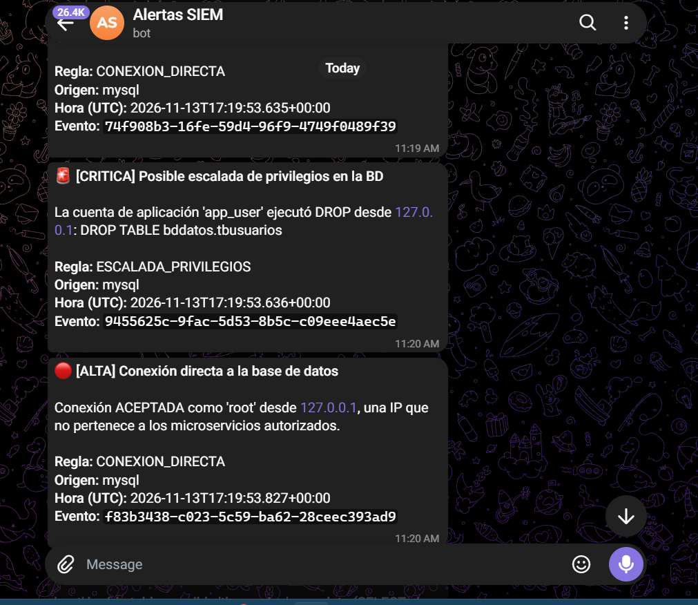
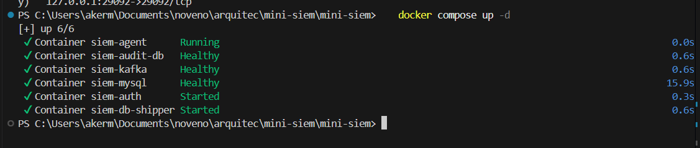
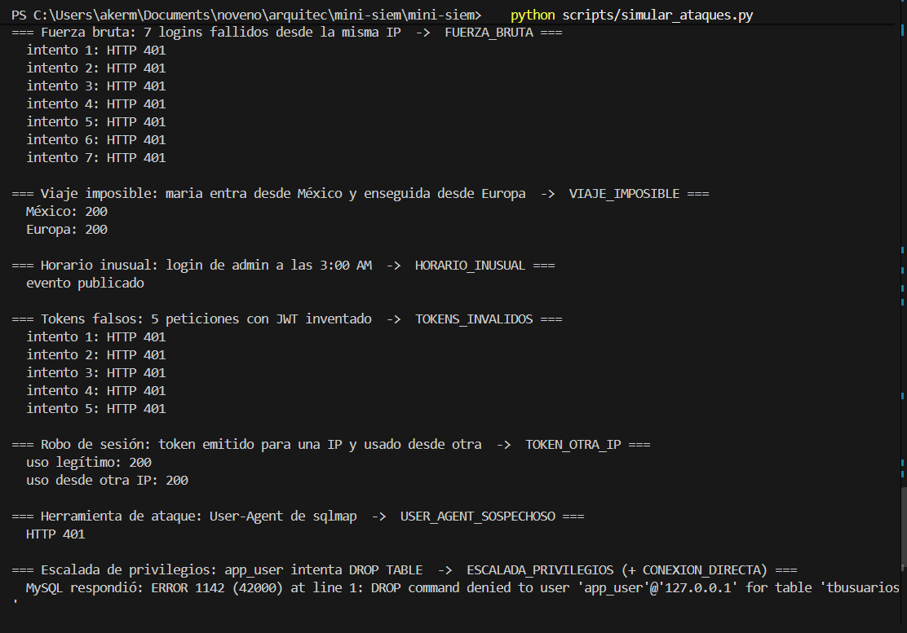
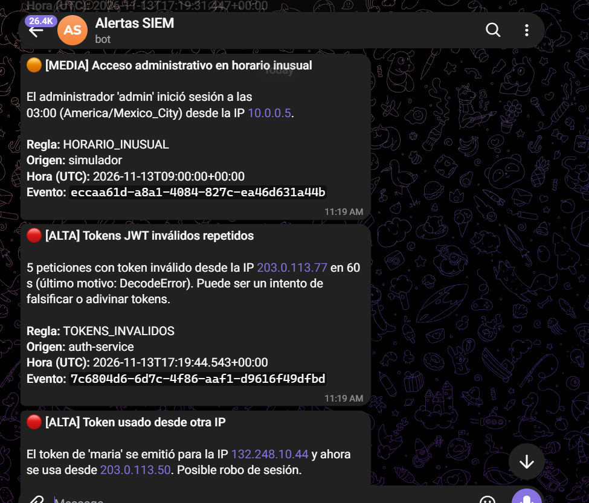
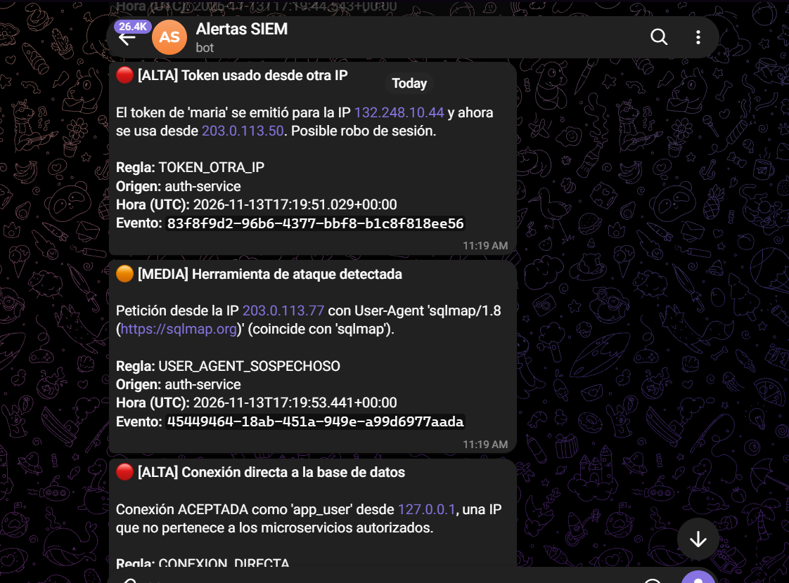
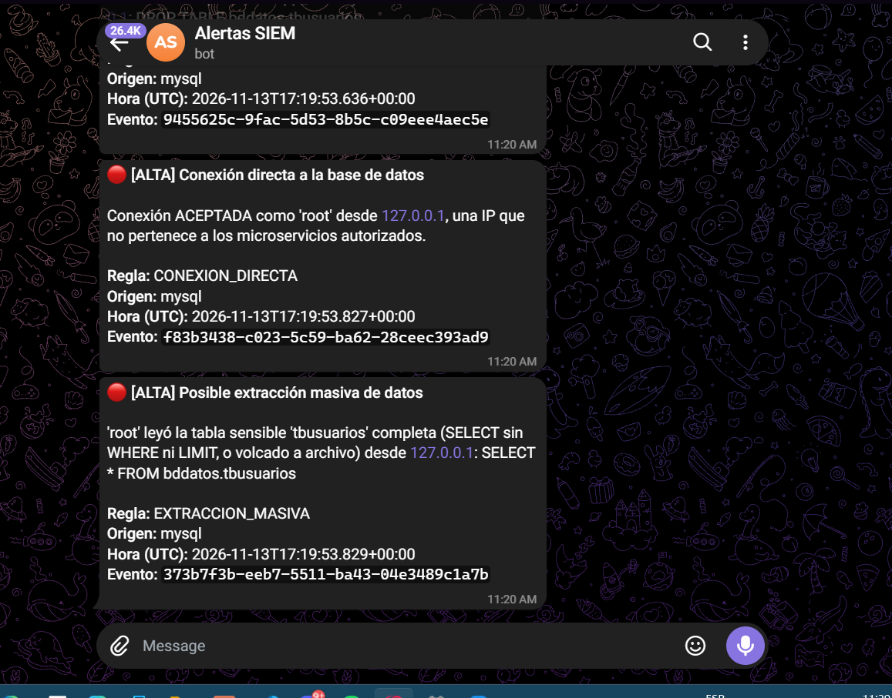

<div align="center">

# Mini-SIEM · Agente de monitoreo de microservicios

**Auditoría y detección de anomalías en tiempo real para microservicios, con arquitectura orientada a eventos y alertas instantáneas en Telegram.**


[Arquitectura](#arquitectura) · [Reglas](#reglas-de-detección) · [Demo](#demo) · [Inicio rápido](#inicio-rápido) · [Documentación (PDF)](docs/Documentacion_Mini-SIEM.pdf)

</div>

---

## Resumen

Un sistema de seguridad tipo **SIEM** a escala de laboratorio. El microservicio de login y el motor de base de datos publican cada intento de acceso en **Apache Kafka**; un **agente en Python** consume esos eventos, aplica **10 reglas de detección** y envía una alerta a **Telegram** en segundos. Toda la evidencia se guarda en una base de auditoría **de solo inserción**, aislada en su propia red, para que un atacante no pueda borrar sus huellas.

En la prueba de extremo a extremo se dispararon **10 alertas en menos de un minuto**, cubriendo ataques al login y a la base de datos.

| | |
|---|---|
| **6** contenedores orquestados con Docker Compose | **10** reglas de detección en dos niveles (Auth y BD) |
| **2** productores de eventos (aplicación y motor de BD) | **20** pruebas unitarias del motor de reglas |

## Arquitectura

<p align="center">
  
</p>

| Componente | Tecnología | Rol |
|---|---|---|
| `auth-service` | Python · FastAPI · JWT · bcrypt | Login. Publica `login_success`, `login_failed`, `token_used` y `token_invalid` en `auth.events`. |
| `mysql` | MySQL 8.4 | Base `bddatos` con la tabla `tbusuarios`. Registra cada conexión y sentencia en `mysql.general_log`. |
| `db-log-shipper` | Python | Convierte el log del motor en eventos `db_connect` y `db_query` en `db.audit`. Detecta si el log se vacía o se apaga. |
| `kafka` | Apache Kafka 4.2 (KRaft) | Canal centralizado y asíncrono de eventos. |
| `security-agent` | Python · confluent-kafka | Consume, analiza, alerta y archiva. Entrega al menos una vez, sin duplicados. |
| `audit-db` | MySQL 8.4 | Almacenamiento inmutable: cuenta con solo `INSERT`, triggers que bloquean `UPDATE`/`DELETE` y red interna sin puertos. |

## Reglas de detección

| Nivel | Regla | Severidad | Se dispara cuando |
|---|---|:---:|---|
| Auth | `FUERZA_BRUTA` | 🔴 Alta | Más de 5 logins fallidos desde la misma IP en 1 minuto |
| Auth | `VIAJE_IMPOSIBLE` | 🔴 Alta | Dos inicios de sesión del mismo usuario exigirían viajar a más de 900 km/h |
| Auth | `HORARIO_INUSUAL` | 🟠 Media | Un administrador entra entre las 00:00 y las 06:00 (hora local) |
| Auth | `TOKENS_INVALIDOS` | 🔴 Alta | 5 JWT inválidos o ausentes desde una IP en 1 minuto |
| Auth | `TOKEN_OTRA_IP` | 🔴 Alta | Un JWT se usa desde una IP distinta a la del login (robo de sesión) |
| Auth | `USER_AGENT_SOSPECHOSO` | 🟠 Media | User-Agent de herramientas de ataque: sqlmap, hydra, nikto… |
| BD | `ESCALADA_PRIVILEGIOS` | 🚨 Crítica | La cuenta de aplicación ejecuta `DROP`, `ALTER`, `GRANT`, `TRUNCATE`… |
| BD | `EXTRACCION_MASIVA` | 🔴 Alta | `SELECT` sobre una tabla sensible sin `WHERE` ni `LIMIT`, o volcado a archivo |
| BD | `CONEXION_DIRECTA` | 🔴 Alta | Conexión a MySQL desde una IP que no es de un microservicio |
| BD | `LOG_AUDITORIA_ALTERADO` | 🚨 Crítica | El log de auditoría del motor fue vaciado o desactivado |

Los umbrales se ajustan con variables de entorno, sin tocar código. El motor de reglas no hace E/S, así que se prueba de forma aislada (`pytest`).

## Demo

El script `scripts/simular_ataques.py` lanza cada ataque contra el login y la base de datos. Resultado real en Telegram:

<table>
  <tr>
    <td width="50%"></td>
    <td width="50%"></td>
  </tr>
  <tr>
    <td align="center"><sub>Fuerza bruta y viaje imposible (Ciudad de México → Alemania, 9,843 km)</sub></td>
    <td align="center"><sub>Escalada de privilegios: <code>DROP TABLE</code> con la cuenta de la aplicación</sub></td>
  </tr>
</table>

<details>
<summary><b>Ver todas las capturas</b></summary>

<br>

| Captura | |
|---|---|
| Servicios levantados con `docker compose up -d` |  |
| Ejecución del simulador de ataques |  |
| Horario inusual y tokens JWT inválidos |  |
| Robo de sesión y herramienta de ataque (sqlmap) |  |
| Conexión directa y extracción masiva de datos |  |

</details>

## Inicio rápido

**Requisitos:** Docker Desktop (o Docker Engine con Compose v2), unos 3 GB de RAM libres, Python 3 para el simulador y un bot de Telegram creado con [@BotFather](https://t.me/BotFather).

```bash
git clone https://github.com/camilohh12/mini-siem.git
cd mini-siem
cp .env.example .env          # en Windows: copy .env.example .env
```

Edita `.env`: define las contraseñas, `JWT_SECRET` (32+ caracteres), `TELEGRAM_BOT_TOKEN` y `TELEGRAM_CHAT_ID`.

```bash
docker compose up -d --build              # construye y levanta los 6 servicios
docker compose ps                         # mysql, kafka y audit-db deben quedar "healthy"
python scripts/simular_ataques.py         # dispara las alertas
```

Usuarios de demostración: `admin / Admin#2026` y `maria / Maria#2026`. La API queda en `http://localhost:8000/docs`.

> Comandos de MySQL, consultas a la auditoría y solución de problemas: [docs/guia-operacion.md](docs/guia-operacion.md).

## Decisiones de diseño

- **Asíncrono por diseño.** El login publica sin esperar a Kafka; si Kafka cae, el login sigue respondiendo y los eventos se reintentan.
- **Entrega al menos una vez.** El agente confirma el offset solo después de archivar el evento; los duplicados se descartan por `event_id`.
- **Mínimo privilegio.** La cuenta de la aplicación solo puede leer `tbusuarios`; la del agente solo puede insertar en la auditoría.
- **Defensa contra borrado de huellas.** Base de auditoría separada, triggers anti-`UPDATE`/`DELETE`, y alerta crítica si alguien vacía o apaga el log del motor.
- **Lectura del log por posición, no por hora.** MySQL escribe la hora en la zona de cada sesión, así que un `SET time_zone` no puede esconder consultas al recolector.
- **Sin filtraciones.** Contraseñas con bcrypt, respuesta idéntica para usuario inexistente o clave incorrecta, consultas parametrizadas y secretos solo en `.env`.

## Estructura

```
mini-siem/
├── docker-compose.yml          # orquestación de los 6 servicios y 2 redes
├── .env.example                # plantilla de configuración
├── auth-service/               # productor 1: login + emisión de eventos
├── db-log-shipper/             # productor 2: mysql.general_log → Kafka
├── security-agent/             # consumidor: reglas, Telegram, archivo inmutable
│   ├── agent.py  rules.py  notifier.py  storage.py  geo.py
│   └── tests/test_reglas.py    # 20 pruebas unitarias
├── mysql/init/                 # tbusuarios y cuentas con mínimo privilegio
├── audit-db/init/              # tablas de auditoría y triggers anti-borrado
├── scripts/simular_ataques.py  # simulador de ataques
└── docs/                       # documentación PDF, guía de operación y capturas
```

## Pruebas

```bash
cd security-agent
pip install pytest requests tzdata
python -m pytest -q             # 20 passed
```

## Limitaciones y trabajo futuro

- **Extracción masiva por heurística:** el log general de MySQL no reporta filas devueltas. Un plugin de auditoría (Percona Audit Log) permitiría medirlas.
- **Kafka sin autenticación:** en producción se requiere SASL, TLS y ACL.
- **Estado en memoria:** los contadores viven en un único agente; para escalar, moverlos a Redis y particionar los topics.
- **Geolocalización externa:** usa ip-api.com; una base local (MaxMind GeoLite2) evitaría enviar IPs a terceros.
- **Siguientes pasos:** dashboard en Grafana, detección con modelos de ML sobre el histórico y respuesta automática (bloqueo de IP).

## Documentación

La documentación completa del proyecto, con el diseño, el código clave y la evidencia de las pruebas, está en [**docs/Documentacion_Mini-SIEM.pdf**](docs/Documentacion_Mini-SIEM.pdf).

## Autor

**Camilo Hernández Hernández**
Ingeniería en Software · Universidad Politécnica de Pachuca
Proyecto de la materia *Arquitectura Orientada a Servicios*, noviembre de 2026.
